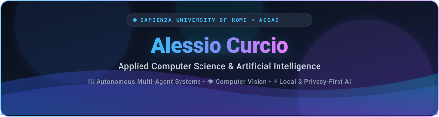
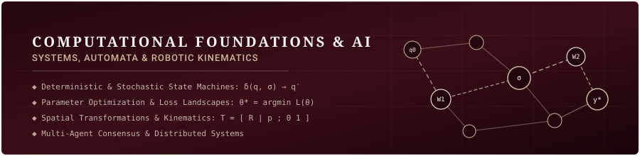

  <!-- Header Banner in Bordeaux & Beige -->
  

    

  <!-- Navigation Badges in Bordeaux & Beige -->
  
  &nbsp;
  
  &nbsp;
  
  &nbsp;
  

 

---

### Overview

Master of Science student in **Artificial Intelligence and Robotics (AIRO)** at **Sapienza University of Rome**, following graduation from the **Applied Computer Science and Artificial Intelligence (ACSAI)** Bachelor of Science curriculum.

Core technical focus centers on autonomous multi-agent systems, real-time computer vision, robotic kinematics, and local, privacy-preserving machine learning architectures.

* **Current Academic Status:** M.Sc. in Artificial Intelligence and Robotics (AIRO), Sapienza University of Rome.
* **Undergraduate Background:** B.Sc. in Applied Computer Science and Artificial Intelligence (ACSAI), Sapienza University of Rome (Graduated).
* **Academic Performance:** Maximum evaluation (30 and 30 cum laude) in university programming examinations for Python and Java.
* **Industrial & Lab Engagements:** Technical research and project delivery with IBM, Ericsson, and Fondazione Mondo Digitale.
* **Problem Solving & Competitions:** Regional and national finalist in Italian Mathematics and Informatics Olympiads; maximum score in the TeraBebras international challenge.
* **Languages:** Italian (Native), English (B2 Certification, English-taught academic degrees).

---

### Conceptual & Aesthetic Perspectives

  
    
  

---

### Technical Competencies

| Domain | Stack & Technologies |
| :--- | :--- |
| **Artificial Intelligence & Robotics** | PyTorch, TensorFlow, YOLOv11, OpenCV, LM Studio, Robotic Kinematics, State Machines |
| **Programming Languages** | Python, Java, C, C++, Go, TypeScript, JavaScript, R, SQL, Bash |
| **Systems & Architecture** | Distributed Systems, Multi-Agent Orchestration, Docker, Linux, WebSocket |
| **Software & Interface Development** | React, Vue.js, PyQt5, Streamlit, PostgreSQL, TailwindCSS |

---

### Selected Projects

<b>Artificial Intelligence &amp; Autonomous Systems</b>

 

* **[OpenSyntax Workspace](https://github.com/Crucio104/OpenSyntax-AI-coding-workspace)**  
  Multi-agent software workspace coordinating autonomous code generation, multi-file project structuring, and local compilation across Python, C, C++, Java, Go, and Rust. Supports local model inference via LM Studio and external endpoints.

* **[Local LLM Email Agent](https://github.com/Crucio104/Email-Ai-Agent)**  
  On-device email categorization and priority analysis tool running through LM Studio. Processes inbox contents locally without transmitting message data to third-party cloud services. Includes custom rules and a desktop GUI.

* **[Voice Cloning Qwen3-TTS](https://github.com/Crucio104/Voice-Cloning-Qwen3-TTS)**  
  Web application implementing zero-shot voice synthesis based on Qwen3-TTS (1.7B). Supports multilingual prosody handling, lossless audio output (WAV, FLAC, MP3), and containerized deployment with Docker.

<b>Computer Vision &amp; Applied Machine Learning</b>

 

* **[League of Legends Automation](https://github.com/Crucio104/Lol-farming-bot)**  
  Vision-based bot implementing real-time screen detection via YOLOv11. Analyzes minion proximity, tracks champion positions, executes skill rotations, and identifies turret boundary hazards.

* **[Stock Market Predictor](https://github.com/Crucio104/Stock-market-predictor)**  
  Time-series forecasting application using Long Short-Term Memory (LSTM) recurrent neural networks. Integrates historical data streaming via Yahoo Finance and technical analysis indicators (MA50, MA100, MA200) within a Streamlit interface.

* **[PDF Text &amp; OCR Extractor](https://github.com/Crucio104/PDF_File_Extractor)**  
  Desktop utility integrating `pdfplumber` and Tesseract OCR for text extraction from scanned documents. Features configurable DPI resolution and export to TXT and DOCX formats.

<b>Distributed Systems &amp; Systems Architecture</b>

 

* **[Echo Messaging System](https://github.com/Crucio104/Echo-messaging-system)**  
  Real-time communication architecture developed for Sapienza's Web and Software Architecture curriculum. Built with a Go backend, Vue.js interface, WebSocket streaming, and Docker Compose orchestration.

* **[Quest for Valentine](https://github.com/Crucio104/Quest-for-Valentine)**  
  Narrative browser application in Vanilla JavaScript featuring branching dialogue state machines, particle animation systems, and multiple conclusion states.

* **[Multicore Programming](https://github.com/Crucio104/Multicore-Programming)**  
  Implementations in concurrent programming, thread synchronization, memory management, and robotic trajectory control in C and C++.

* **[Cross-Platform Portfolio](https://github.com/Crucio104/Site)**  
  Cross-platform application built using Python and the Flet framework for desktop, mobile, and web interfaces.

---

### Academic & Industrial Experience

<b>Institutional Background &amp; Competitions</b>

 

* **IBM &amp; Digital Labs:** Conducted big data analytics research aimed at constructing data-driven psychological profiles; engineered conversational customer service interfaces using IBM Cloud and Watson services.
* **Ericsson &amp; Fondazione Mondo Digitale:** Participated in technical labs and digital skills acceleration programs, addressing telecommunications and software engineering problem sets.
* **Problem Solving &amp; Competitions:**
  - Regional and national stages in Italian Mathematics and Computer Science Olympiads.
  - TeraBebras International Competition: Achieved the maximum possible score in computational thinking and algorithm design.
* **Academic History:**
  - Master of Science in Artificial Intelligence and Robotics (AIRO), Sapienza University of Rome (Enrolled).
  - Bachelor of Science in Applied Computer Science and Artificial Intelligence (ACSAI), Sapienza University of Rome (Graduated).
  - Scientific High School Diploma (Applied Sciences / Computer Science curriculum): 98/100.

---

  
Available for academic research inquiries and software engineering collaborations.

  
  &nbsp;
  
  &nbsp;
  

    

  

